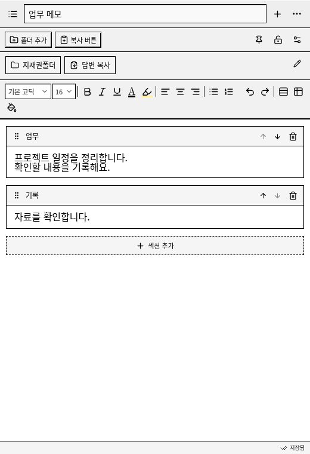
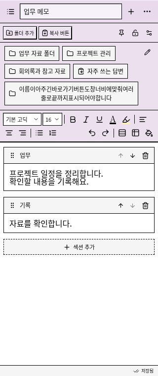

# MEMO 1.4.0

귀여운 도트 메모장 아이콘과 읽기 쉬운 기본 고딕 UI를 사용하는 Windows 메모장입니다. 기본은 검정 글씨·검정 테두리·흰 본문이며, 상단·버튼·팝업·섹션 제목 등 옅은 배경은 회색입니다. 섹션 높이는 내용에 맞게 자동으로 늘고 줄어듭니다. 기기에 자동 저장됩니다. 직접 지정한 메모·버튼·상단 색상은 유지됩니다.





**[Windows 1.4.0 ZIP 다운로드](https://github.com/leejiwon921215-star/MEMO/raw/refs/heads/downloads/MEMO-Windows-1.4.0.zip)**

ZIP을 모두 압축 해제하고, 기존 앱을 완전히 종료한 뒤 안의 새 실행 파일을 여세요. `%APPDATA%\MEMO`의 기존 메모와 폴더 연결, 창 고정 설정은 유지됩니다. 중요한 기록은 업데이트 전에 상단 메뉴 → ‘백업 저장’으로 보관할 수 있습니다. 이 빌드는 코드 서명이 없는 Windows 10/11 x64 개발 빌드입니다.

## 사용법

- **목록에서 삭제·정렬:** 상단 목록 아이콘을 누른 뒤 각 메모 오른쪽 휴지통 버튼으로 삭제합니다. 확인창에서 취소할 수 있습니다. 왼쪽 이동 손잡이를 끌거나 위·아래 버튼으로 메모 순서를 바꾸세요. 검색·즐겨찾기 화면에서도 표시된 항목을 기준으로 이동할 수 있습니다.
- **섹션 정렬:** 섹션 왼쪽 손잡이를 잡아 다른 섹션 위아래로 끌거나 위·아래 화살표를 누릅니다. 내용과 순서는 자동 저장됩니다.
- **줄 간격·여백:** 본문에 커서를 놓거나 문단을 선택한 뒤 서식 도구의 ‘줄 간격과 문단 여백’을 누르세요. 기본 줄 간격은 1배, 문단 위·아래 여백은 0px입니다. 줄 간격 배율과 문단 위·아래 여백(px)을 지정할 수 있고, 기존에 직접 설정한 간격은 유지합니다.
- **최근 색·색상 즐겨찾기:** A(글씨색) 또는 형광펜 아이콘을 누르면 최근 사용 색이 나옵니다. 현재 색이나 최근 색 옆 별표를 눌러 즐겨찾기에 보관하세요. 형광색은 기본색·최근 색·즐겨찾기를 선택하면 즉시 적용되고 색상창이 닫힙니다. 직접 색을 고를 때도 완료 버튼을 따로 누르지 않습니다. 버튼·글씨·형광색·상단·본문·팝업 등 모든 색 설정이 같은 즐겨찾기와 최근 색을 사용하며, 즐겨찾기 64개와 최근 색 12개를 지원합니다. 기존에 따로 저장한 글씨색·형광색 즐겨찾기는 합쳐서 보존합니다.
- **표:** 서식 도구의 표 아이콘 → 행·열 수 선택 → ‘표 넣기’. 표 안을 클릭하면 행 추가·열 추가·행 삭제·열 삭제·표 삭제 버튼이 나옵니다. 삭제 시 확인창이 나타나고 열 너비도 드래그로 조절할 수 있습니다.
- **버튼 색상:** 바로가기 관리에서 버튼을 수정할 때 ‘버튼 배경색’을 고르세요. 본문에 넣은 폴더·복사 버튼은 오른쪽 클릭으로 수정할 수 있습니다. ‘버튼 기본색’으로 되돌릴 수 있습니다.
- **버튼 색상 일괄 적용:** 바로가기 관리 → ‘버튼 색상 일괄 변경’을 펼치고 변경할 버튼을 체크하세요. 상단 및 모든 메모 본문에 넣은 폴더·복사 버튼을 선택할 수 있습니다. 색을 고른 뒤 ‘N개 버튼에 적용’을 누르면 선택한 버튼만 바뀝니다. ‘전체 선택’과 ‘선택 버튼 기본색’도 지원합니다. 경로·복사 내용은 유지합니다.
- **상단 색상:** 위쪽 `⋯` 메뉴 → ‘상단 색상 설정’에서 원하는 색을 고르세요. 기본 색상 선택과 사용자 지정 색을 지원하며 다시 실행해도 유지됩니다. ‘창·팝업·선 색상 설정’을 펼치면 팝업과 섹션 제목의 배경색, 화면 글씨색과 테두리색도 바꿀 수 있습니다. ‘기본색으로’를 누르면 상단과 화면 색상이 검정·회색·흰색 기본값으로 돌아옵니다. 메모 본문의 배경색과 개별 버튼 색은 별도로 유지됩니다.
- **창 크기:** 처음에는 520px 폭으로 열립니다. 창 가장자리를 드래그하거나 상단의 조절 아이콘 → ‘창 크기 설정’에서 숫자로 지정하세요. 최소 320 × 360px입니다. 자물쇠 버튼으로 현재 크기를 고정하거나 해제합니다. 크기·위치·고정 여부는 재실행 후에도 유지됩니다.
- **제목·메모 전환:** 맨 위의 작은 제목 칸에서 바로 이름을 바꿉니다. 왼쪽 목록 아이콘에서 다른 메모를 선택·검색할 수 있고, `+`로 새 메모를 만듭니다. 즐겨찾기·백업·삭제는 위쪽 `⋯` 메뉴에 있습니다.
- **폴더 버튼:** 상단 ‘폴더 추가’ → 버튼 이름 → 폴더 선택 → ‘상단 고정’ 또는 ‘본문 커서 위치’ → ‘버튼 추가’. 버튼을 누르면 Windows 탐색기가 열립니다. 원본 폴더와 파일을 수정하거나 삭제하지 않습니다.
- **복사 버튼:** 상단 ‘복사 버튼’에서 ‘저장된 메모’ 또는 ‘직접 입력한 문구’를 선택하세요. 저장된 메모를 연결하면 버튼을 누르는 시점의 최신 본문을 줄바꿈과 함께 클립보드에 복사합니다. 다른 프로그램에서 Ctrl+V로 붙여 넣을 수 있습니다. 상단 고정과 본문 커서 위치를 모두 지원합니다.
- **버튼 관리:** 상단 바로가기 오른쪽 연필 버튼에서 이름·경로·문구·복사 대상 메모를 수정하고 순서를 바꿀 수 있습니다. 버튼 삭제 전에는 확인창이 나타납니다. 본문 버튼은 오른쪽 클릭으로 수정하고, 편집기에서 선택한 뒤 Delete 키로 제거할 수 있습니다.
- **본문·섹션:** 서식 도구로 글꼴·크기·굵게·기울임·밑줄·정렬·글씨색·형광색·배경색을 설정합니다. UI와 새 본문의 기본 글꼴은 고딕이며 기존 본문에서 직접 선택한 글꼴은 보존합니다. 내용이 짧으면 섹션 높이도 자동으로 줄어듭니다. 섹션별 제목과 내용을 수정할 수 있고 삭제 전 확인창이 표시됩니다.
- **항상 위에:** 핀 아이콘으로 다른 창 위에 표시하도록 설정합니다. 크기 고정과 별개의 설정입니다.

상단 기능과 바로가기는 본문을 스크롤해도 계속 표시됩니다. 창이 좁아지면 폴더·복사 바로가기는 다음 줄로 내려가며 긴 이름도 여러 줄로 표시합니다. 버튼이 아주 많아지면 상단 영역을 세로로 스크롤해 접근할 수 있습니다. 메모를 복사하는 버튼은 글 서식 대신 본문 텍스트를 복사합니다. 복사 대상 메모를 삭제한 경우 버튼 관리에서 새 메모를 연결하세요.

## 저장과 백업

메모와 상단 바로가기는 `%APPDATA%\MEMO\memos.json`, 창 설정은 같은 폴더의 `preferences.json`에 저장됩니다. 계정이나 인터넷 연결이 필요 없으며 기기 간 자동 동기화는 없습니다. JSON 백업을 가져오면 기존 메모를 지우지 않고 추가하며 복사 버튼의 연결도 가져온 메모로 유지합니다. 상단 색상 설정이 있는 백업을 가져오면 해당 색상도 적용하며, 색상 즐겨찾기는 현재 설정과 합칩니다. 백업에는 폴더의 경로가 포함되지만 그 안의 파일은 포함되지 않습니다.

Windows 실행 파일은 공식 LZMA SDK 25.01의 공개 도메인 모듈로 만든 자체 압축 해제 파일입니다. 실행 시 임시 폴더에 앱을 풀고 종료 후 정리하며, 메모는 위의 AppData 경로에 별도로 유지됩니다.

## 개발과 검증

Node.js 24 LTS와 npm을 사용합니다. 클라우드 작업은 이미 격리되어 있으므로 `/workspace/MEMO`의 기존 체크아웃을 사용하고, 사용자가 요청하지 않는 한 별도 Git worktree를 만들지 않습니다.

```sh
cd /workspace/MEMO
npm ci
npm run dev
```

Windows 개발용 실행은 `npm run desktop`입니다. 브라우저에서는 편집·저장·백업·클립보드 복사를 사용할 수 있지만, 탐색기 열기와 창 고정·창 크기 제어는 데스크톱 앱에서만 동작합니다. 브라우저 저장소와 데스크톱 저장소는 별도이므로 백업으로 옮기세요.

```sh
npm run build
npx playwright install chromium
npm test -- --workers=3
npm run test:native
```

브라우저 테스트는 `/usr/bin/chromium`이 있으면 사용하고, 별도 경로는 `MEMO_CHROMIUM_PATH`로 설정할 수 있습니다. 실제 Electron 테스트는 임시 프로필에서 메모·바로가기 저장과 재실행, 클립보드 복사, 창 크기 변경·고정·복원, IPC와 폴더 경로 검증을 확인합니다. 디스플레이가 없는 Linux에서는 실제 창 겹침 검사만 건너뜁니다. 실제 Windows에서 탐색기 열기와 다른 창 위 표시를 최종 확인하세요.

클라우드 프록시와 쓰기 가능한 캐시 경로로 재설치:

```sh
export XDG_CACHE_HOME=/workspace/.cache
export npm_config_cache=/workspace/.cache/npm
export NODE_USE_ENV_PROXY=1
npm ci --no-audit --no-fund
npm run build
```

TLS와 패키지 무결성 검증을 유지합니다. 개발 서버는 환경을 다시 시작한 뒤 재실행해야 합니다.

## Windows 패키징

```sh
npm run package:portable
```

`release/MEMO-Windows-1.4.0.exe`, 이를 담은 `release/MEMO-Windows-1.4.0.zip`, 각각의 SHA-256 파일을 생성합니다. SVG 원본으로 PNG·ICO 아이콘을 생성합니다. SDK 다운로드의 TLS와 고정 SHA-256을 검증한 뒤 공식 7zSD.sfx 모듈을 결합하고 전체 압축 무결성을 검사합니다. Windows 앱과 압축 해제 실행 파일 모두에 새 아이콘을 넣고, 아이콘 이외의 리소스(ASAR 무결성 포함)와 코드 섹션이 보존되는지 검사합니다. 새 빌드는 코드 서명이 없는 상태로 생성합니다. Linux에서도 Wine 없이 만들 수 있습니다.

ZIP 빌드는 `npm run package:win -- --x64`로 `release/MEMO-1.4.0-win-x64.zip`을 생성합니다. ZIP은 전부 압축 해제한 뒤 `MEMO.exe`를 실행합니다. NSIS 설치 프로그램은 `npm run package:win:installer -- --x64`로 만들며 Windows 또는 Wine이 필요합니다. 빌드 결과는 소스 브랜치에 포함하지 않습니다. `downloads` 브랜치에는 다운로드용 실행본을 별도로 게시합니다.

## 글꼴

선택 가능한 본문 도트 글꼴은 [Neo둥근모 v1.601](https://github.com/neodgm/neodgm/releases/tag/v1.601)입니다. 오프라인 사용을 위해 앱에 포함하며 SIL Open Font License 전문은 `public/fonts/OFL.txt`에 있습니다.
